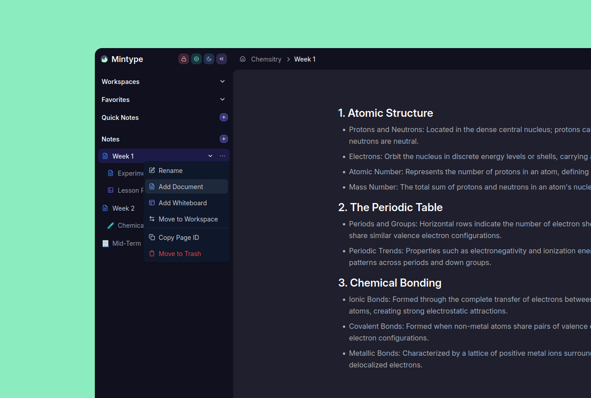
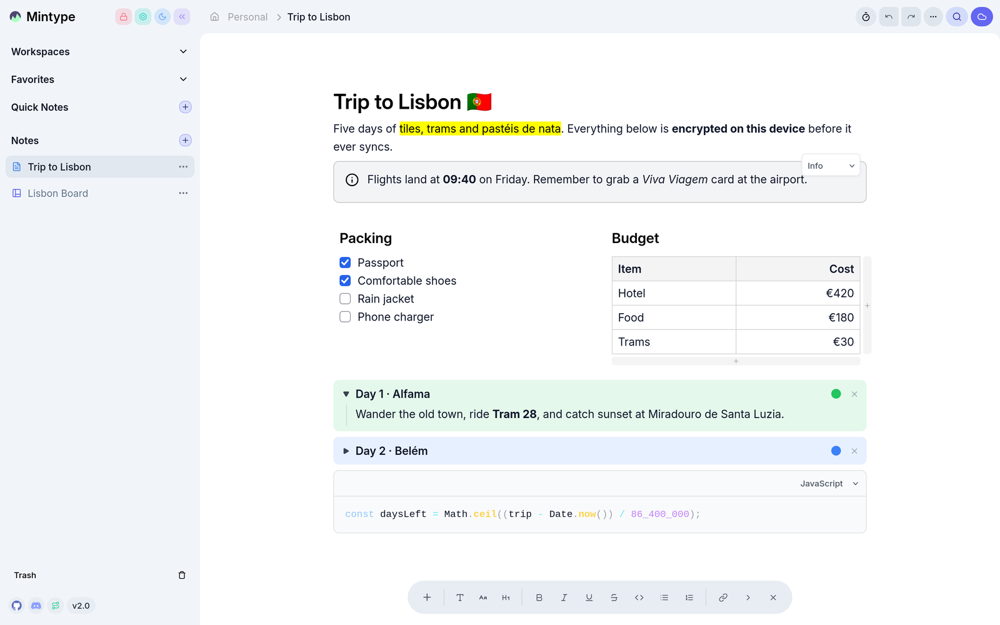
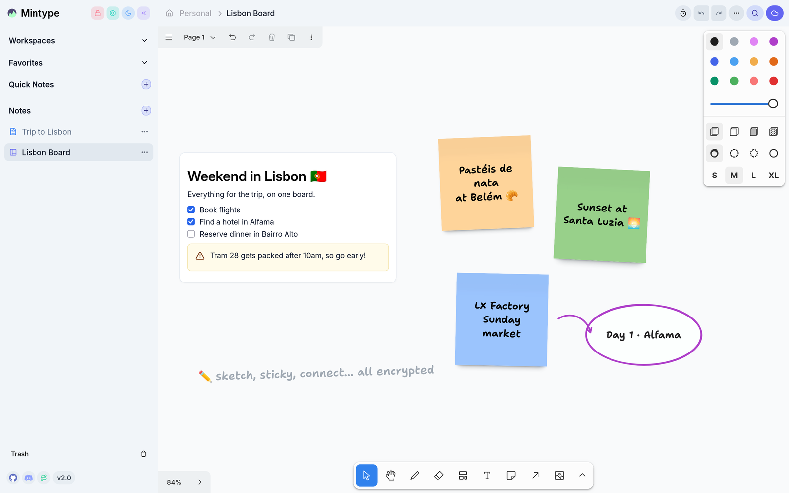
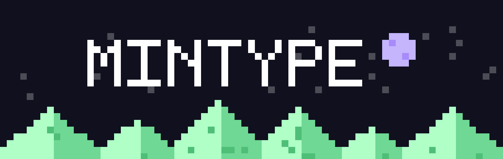

# Mintype: a free, zero-knowledge note-taking app

<p align="center">
  
</p>

<p align="center">
  <a href="https://mintype.app">Open Mintype</a> ·
  <a href="https://github.com/project59/mintype/discussions">Discussions</a> ·
  <a href="https://github.com/orgs/project59/projects/1">Roadmap</a> ·
  <a href="https://discord.gg/JyJH5seZqj">Discord</a> ·
  <a href="https://github.com/sponsors/project59">Sponsor ❤️</a>
</p>

Mintype is a notes app for documents and whiteboards. Everything is encrypted on your device before it is saved or synced, so only you can read your notes. It works offline, runs in any modern browser, and syncs free through your own Google Drive.

## What's new in 2.0 🎉

Version 2.0 is a ground-up rework of the editor and whiteboard:

- **A brand-new whiteboard** with an infinite canvas, sticky notes, shapes, drawing, connectors, grouping, images, and export.
- **A smoother, Markdown-based editor.** Documents are now one continuous page instead of separate blocks, and they export cleanly to Markdown.
- **New blocks:** sections, columns, tables, callouts, to-do lists, code, Google Maps, and YouTube. Type `/` to insert any of them.
- **QuickShare is back,** with end-to-end encryption. Share a document or whiteboard with a link, and anyone who opens it can save a copy to their own workspace.
- **Better on phones,** with bottom-sheet menus, a scrollable toolbar, and a tap menu for moving blocks.
- **More reliable Google Drive sync and import/export.**

See the full [v2.0 release notes](https://github.com/project59/mintype/discussions) for details.

## Features

### 🔒 Private by design

- All notes are encrypted on your device (AES-GCM) before they are written to browser storage.
- Notes unlock only with your password, which is never stored anywhere.
- Notes are encrypted before they reach Google Drive. Open your Drive folder and you will see ciphertext.
- Mark a page as **sensitive** to require your password again before it opens. This helps if you leave your device unattended.
- QuickShare links carry their decryption key in the part of the URL that never reaches a server. Mintype only stores the encrypted file.

### ✍️ Documents

<p align="center">
  
</p>

- Rich text with fonts, sizes, colours, highlights, links, and page mentions (`@`).
- Blocks for callouts, collapsible coloured sections, 2–4 column layouts, tables, to-do lists, code with syntax highlighting, images, YouTube, and Google Maps.
- Drag any block by its handle, or tap the handle on a phone to move, duplicate, or delete it.
- Everything is stored as Markdown, so your notes stay portable.

### 🖼️ Whiteboards

<p align="center">
  
</p>

- An infinite canvas with sticky notes, shapes, freehand drawing, arrows, groups, and images.
- **Markdown boxes** put the full document editor onto the canvas: to-dos, callouts, tables, and more.
- Follows the app's light or dark theme.

### 📱 Works everywhere, even offline

- A web app that works in any modern browser. Chrome and Firefox are recommended on desktop.
- Install it as an app (PWA): use Chrome on Android or Safari on iOS for the most native feel.
- Fully usable offline. Changes are queued and sync when you are back online.
- Phones get every feature, with menus that open as easy-to-tap bottom sheets.

### 🗂️ Simple organisation

- A familiar **workspace → page → sub-page** structure.
- **Quick Notes** for jotting things down on the go and organising later.
- Favourites, a trash folder, drag-and-drop reordering, and moving pages between workspaces.
- Search across documents and whiteboards.
- Import from Notion, Markdown, or Mintype JSON. Export to Markdown or encrypted JSON backups.
- Light and dark mode.

## FAQ

### Is Mintype free?

Yes. Mintype is free to use and will stay free, including Google Drive sync. If you would like to support development, you can [sponsor on GitHub](https://github.com/sponsors/project59) or [buy me a coffee](https://buymeacoffee.com/project59).

### Is syncing secure?

Yes. Mintype syncs through your own Google Drive and runs entirely in your browser, so your notes never pass through Mintype's servers. Every note is encrypted before it reaches Google's APIs.

### Who can read my notes?

Only you. Notes are encrypted with a key protected by your password and stored on your device and, optionally, in your Google Drive. Your password is never stored, not even on your device, and Mintype keeps no copy of your notes.

### Do you collect any data?

There are no trackers. Mintype uses Supabase for accounts and Google APIs for Drive sync. If you create an account, we store your email and **encrypted** copies of your keys, so you can sign in easily on a new device. Your email is never shared with third parties. QuickShare stores only the encrypted file you choose to share.

### Is it available on macOS, Linux, Windows, Android and iOS?

Yes. Mintype runs anywhere with a modern browser. Chrome and Firefox are recommended on desktop, Chrome on Android, and Safari on iOS (for PWA install).

### Are native desktop or mobile apps planned?

A desktop version built on Electron is planned. It will save notes directly to disk instead of browser storage, so you can sync and back them up your own way (git, OneDrive, Syncthing, and so on). Native mobile apps are not currently planned, but may come if they become necessary for mobile-only features.

### How can I get in touch or report a bug?

- [GitHub Issues](https://github.com/project59/mintype/issues) for bugs and feature requests
- [GitHub Discussions](https://github.com/project59/mintype/discussions) for announcements and questions
- [Roadmap](https://github.com/orgs/project59/projects/1)
- [Discord](https://discord.gg/JyJH5seZqj)

## Local development

### Prerequisites

- [Node.js](https://nodejs.org/) 20.19 or newer, with npm
- A modern browser (Chrome or Firefox)

### Setup

```bash
git clone https://github.com/project59/mintype.git
cd mintype
npm install
```

Create a `.env` file in the project root:

```bash
# Required: the app will not start without these (placeholders are fine for offline-only use)
VITE_SUPABASE_URL=http://localhost:54321
VITE_SUPABASE_ANON_KEY=placeholder

# Optional: needed for accounts, Google Drive sync and QuickShare
VITE_BACKEND_URL=
VITE_FRONTEND_URL=http://localhost:5173
VITE_API_KEY=
```

| Variable | Used for |
| --- | --- |
| `VITE_SUPABASE_URL`, `VITE_SUPABASE_ANON_KEY` | Account sign-in (Supabase). Required to boot. Placeholders work if you only use local, offline notes. |
| `VITE_BACKEND_URL` | The Mintype API server, used by Drive token refresh, key backup, profile settings, and QuickShare. |
| `VITE_FRONTEND_URL` | Where Google sign-in redirects back to, usually your dev server URL. |
| `VITE_API_KEY` | Google API key for Drive sync. |

Everything else works without a backend: creating a password, writing documents and whiteboards, search, and import/export all happen in the browser.

### Run it

```bash
npm run dev
```

Open the URL Vite prints (usually http://localhost:5173), click **Enter Workspace**, and choose **New Setup** to create a local password.

### Useful commands

| Command | What it does |
| --- | --- |
| `npm run dev` | Start the dev server with hot reload |
| `npm run build` | Build the production bundle into `dist/` |
| `npm run preview` | Serve the production build locally |
| `npm run lint` | Run ESLint |
| `npm run check:markdown` | Round-trip test for the editor's Markdown parsing and serialisation |

While the dev server is running, `/parity.html` compares how whiteboard Markdown boxes look when idle and while editing.

### Project layout

```text
src/
  apps/            app router
  pages/           page, workspace, QuickShare and settings screens
  layouts/         app shell, auth and encryption (secure context)
  render/editor/   TipTap editor, custom blocks and Markdown
  render/whiteboard/  tldraw canvas and encrypted persistence
  lib/             encrypted storage (IndexedDB) and the Drive sync engine
  components/      shared UI, import/export, search, trash, QuickShare
  drivesync/       Google Drive integration
```

Built with React, Vite, Tailwind CSS, [TipTap](https://tiptap.dev), and [tldraw](https://tldraw.dev). See [`AGENTS.md`](AGENTS.md) for in-depth architecture notes.

### Contributing

Bug reports, feature requests, and small fixes are welcome through [GitHub Issues](https://github.com/project59/mintype/issues). I'm not taking on dedicated contributors right now.

## Support Mintype

Mintype is an independent project. If it is useful to you, please consider supporting it:

- [GitHub Sponsors](https://github.com/sponsors/project59)
- [Buy Me a Coffee](https://buymeacoffee.com/project59)

## Star History

<a href="https://www.star-history.com/#project59/mintype&type=date&legend=bottom-right">
 <picture>
   <source media="(prefers-color-scheme: dark)" srcset="https://api.star-history.com/svg?repos=project59/mintype&type=date&theme=dark&legend=bottom-right" />
   <source media="(prefers-color-scheme: light)" srcset="https://api.star-history.com/svg?repos=project59/mintype&type=date&legend=bottom-right" />
   
 </picture>
</a>


